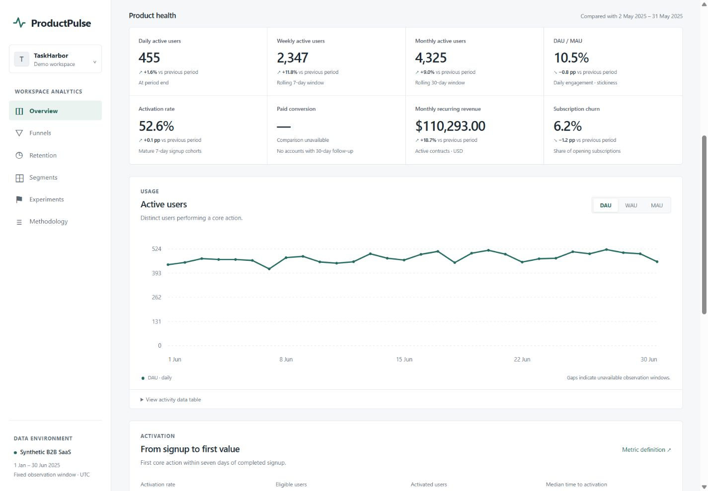
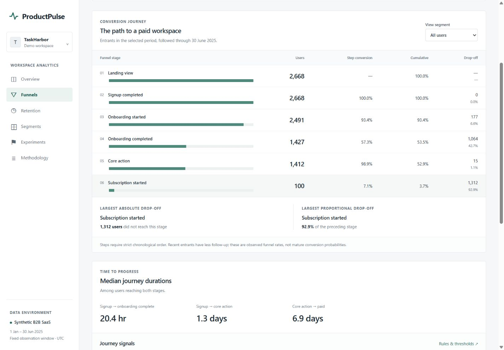
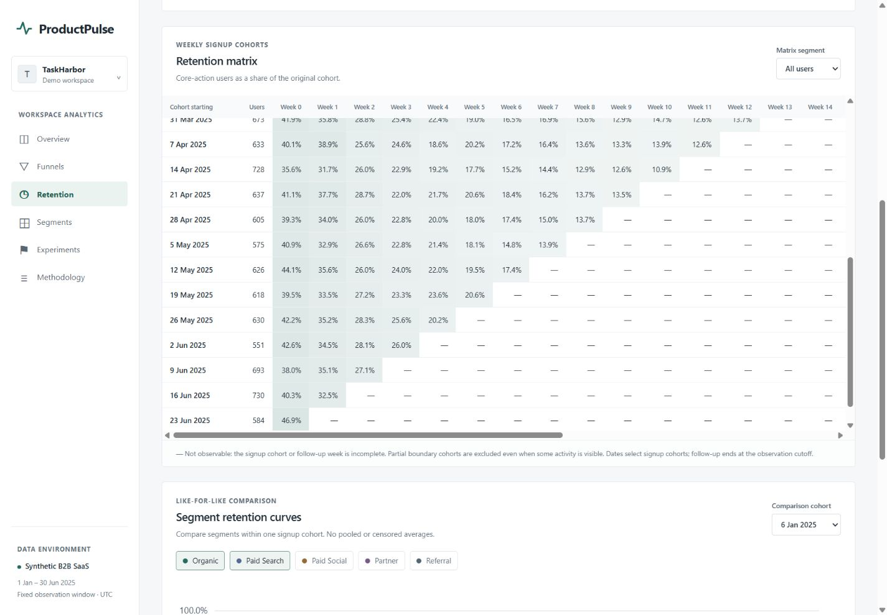
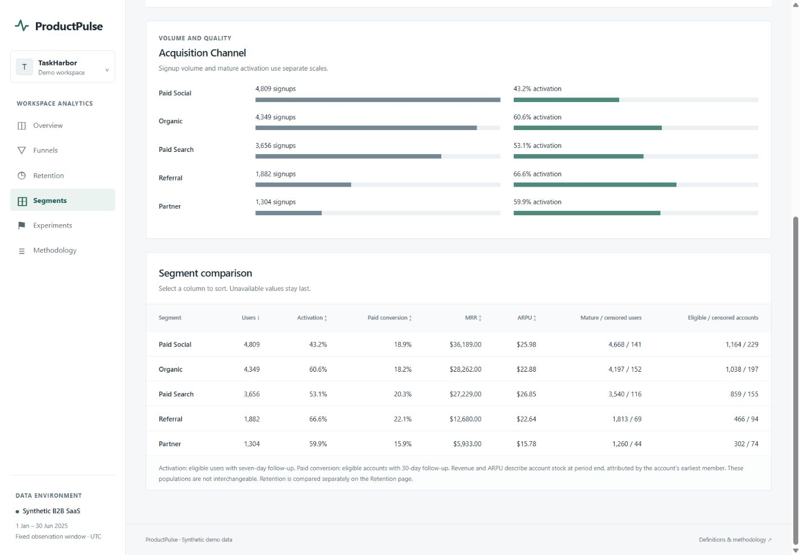
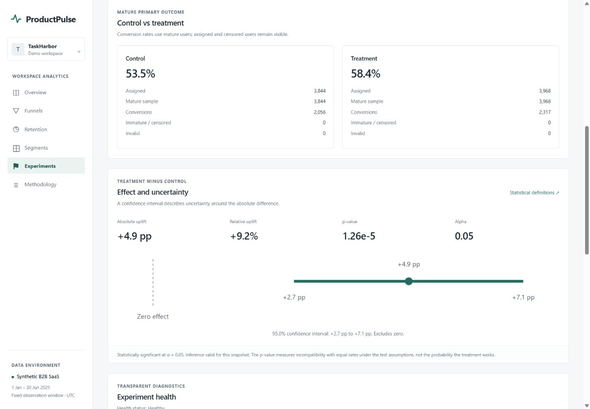
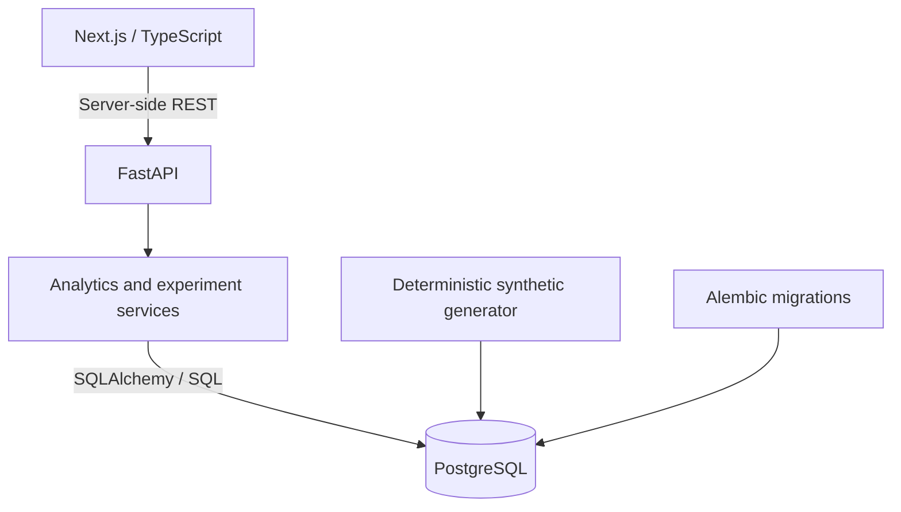

# ProductPulse

**Product Analytics & Experimentation Platform**

SQL-first product analytics and experimentation for product managers and analysts exploring a
B2B SaaS product. ProductPulse connects usage, activation, funnels, cohort retention, segmentation,
account revenue and A/B test evidence in one local workspace.

PostgreSQL owns analytical aggregation; FastAPI owns metric definitions and statistical inference;
Next.js and TypeScript present the results. Deterministic insights expose their evidence and rules.

**Portfolio demonstration, not a production service.** All data is synthetic. TaskHarbor is a
fictional product; no real customer data is included. Behavioral patterns are intentionally generated
for analytical demonstration. Results illustrate workflows, not commercial achievements.



## What the platform answers

- Is usage changing compared with the previous period?
- Where do users leave onboarding, and which segments need investigation?
- Which channels bring activation and retention quality rather than volume alone?
- Are newer cohorts mature enough to compare fairly?
- What do account conversion, recurring revenue and churn reveal?
- Does an experiment have useful evidence, adequate maturity and healthy allocation?

A product manager starts with a material change on **Overview**, inspects the ordered **Funnel**,
compares the affected **Segment**, checks its **Retention**, then reviews **Experiment** evidence.
The workspace connects observation with investigation; it does not automatically prescribe rollout.

## Screenshots

Current running release, real seeded PostgreSQL data, consistent desktop viewport. Screenshots
show selected analytical sections; wide retention tables scroll within their panel.

| Funnels                                                    | Retention                                           |
| ---------------------------------------------------------- | --------------------------------------------------- |
|  |  |

| Segments                                             | Experiments                                              |
| ---------------------------------------------------- | -------------------------------------------------------- |
|  |  |

[Methodology screenshot](docs/screenshots/methodology.jpg)

## Core capabilities

| Area           | Analytical scope                                                                               |
| -------------- | ---------------------------------------------------------------------------------------------- |
| Product health | DAU / WAU / MAU, stickiness, equal-length period comparisons                                   |
| Activation     | Seven-day maturity, time to first value, acquisition breakdown                                 |
| Funnels        | Chronological progression, losses, durations, segment comparison                               |
| Retention      | Weekly signup cohorts, matrix, segment curves, explicit censoring                              |
| Segments       | Acquisition channel, company size, country, device type                                        |
| Monetization   | Account paid conversion, MRR, ARPU, new/churned MRR, subscription churn                        |
| Experiments    | Control/treatment, uplift, confidence intervals, p-values, SRM, MDE, planning, decision states |

## Architecture



Frontend: interaction, formatting and accessible presentation. Backend: analytical definitions
and statistical logic. PostgreSQL: time filtering, cohort construction and aggregation. Analytics
requests use read-only repeatable-read transactions. One backend application, not microservices.
[Architecture details](docs/ARCHITECTURE.md).

## Analytical methodology

- Core-action events define active use; rolling windows must be fully observable.
- Activation requires seven-day follow-up. Recent users are explicitly censored.
- Funnels require strictly increasing timestamps. Observed funnel rates, mature activation and
  account paid conversion use different populations; denominators are not interchangeable.
- Retention compares cohorts at the same age. Unobservable cells are unavailable, never 0%.
- Churn divides cancellations from the opening subscription stock by opening subscriptions.
- Experiments use ITT-style assignment populations, mature binary outcomes, two-sided proportion
  tests, Wilson/Newcombe intervals, SRM checks and fixed-horizon frequentist analysis.
- MDE/planning describe sensitivity under stated assumptions. Significance alone is not a rollout
  recommendation. Descriptive insights do not establish causality.

Details: [metric contracts](docs/METRICS.md), [analytics](docs/ANALYTICS.md),
[experimentation](docs/EXPERIMENTATION.md), [decision rules](docs/DECISION_INSIGHTS.md).

## Synthetic dataset

Seed **42**, fixed observation window **1 January–30 June 2025 UTC**:

| Entity                 |    Rows |
| ---------------------- | ------: |
| Users                  |  16,000 |
| Events                 | 185,249 |
| Accounts               |   4,578 |
| Subscriptions          |     834 |
| Experiments            |       2 |
| Experiment assignments |  16,000 |

Five acquisition channels, four company sizes, five countries and synthetic device labels.
Paid subscriptions use pro/business plans; unconverted accounts remain free.
[Generation assumptions](docs/SYNTHETIC_DATA.md) explain the intentionally designed patterns.
Normal startup preserves data. These are demonstration records, not actual business performance.

## Tech stack

- **Frontend:** Next.js 16, React 19, TypeScript, Tailwind CSS, OpenAPI types and Ajv.
- **Backend:** Python 3.12, FastAPI, SQLAlchemy 2, Alembic, psycopg; standard-library statistics.
- **Data / runtime:** PostgreSQL 17, Docker Compose, Node 24, pnpm 11.25.0.
- **Quality:** pytest/coverage, Ruff, Vitest/Testing Library, ESLint, Prettier, TypeScript, GitHub Actions.

Dependencies are pinned in Python requirements and the pnpm lockfile. No SciPy, LLM or tracking SDK.

## Local quick start

**Windows:** install and start Docker Desktop (Linux containers / Compose v2), clone or download
this repository, then double-click **`START_PRODUCT_PULSE.bat`**.

It builds the applications, waits for PostgreSQL, migrates, initializes missing demo data and opens
**http://localhost:3000**. First startup needs internet access and may take several minutes.
No host Python or Node installation is required.

Double-click **`STOP_PRODUCT_PULSE.bat`** to stop only this project's containers. The database
persists. Start again to resume. No global process termination, database reset or Docker prune.

The launcher creates ignored `.runtime/local.env` with a random local database password. Keep
that file with the persistent volume; editing its password does not rotate PostgreSQL's password.
Default loopback ports: UI **3000**, API **8000**, PostgreSQL **5432**. If occupied, edit the ports
in that file and restart. The browser follows the configured frontend port.

**macOS/Linux or manual Compose:** copy `.env.example` to `.env`, replace `replace_me` with a local
alphanumeric password, including in `DATABASE_URL`, then:

```sh
docker compose up -d --build --wait
docker compose stop
```

Use only one environment file per persistent Compose project. Do not switch between the Windows
launcher's credentials and manual `.env` on the same initialized volume.
[Local operation and recovery](docs/LOCAL_DEMO.md).

API health: http://localhost:8000/health · OpenAPI UI: http://localhost:8000/docs.
All exposed ports bind to localhost. No cloud deployment is included.

## Development, testing and CI

[Developer guide](docs/DEVELOPMENT.md) includes host startup and database setup. Use **pnpm** and
its authoritative `pnpm-lock.yaml`; do not mix package managers.

```sh
# Root; Python 3.12 virtual environment activated
pip install -r backend/requirements.lock
ruff check --config backend/pyproject.toml backend scripts
ruff format --check --config backend/pyproject.toml backend scripts
# In backend; TEST_DATABASE_URL must point to a separate disposable *_test database
pytest --cov=app --cov-report=term-missing
# In frontend; Node 24 and pnpm 11.25.0
pnpm install --frozen-lockfile
pnpm lint
pnpm format:check
pnpm typecheck
pnpm test
pnpm build
```

[GitHub Actions](.github/workflows/ci.yml) runs on push and pull request, using real PostgreSQL.
No successful remote CI badge is claimed before an actual remote run. Exact local release results
are in [release validation](docs/RELEASE.md). Browser review is manual; Playwright is not a dependency.

## Project structure

```text
ProductPulse/
  backend/                     API, analytics, inference, seed, migrations, tests
  frontend/                    Six routes, typed integration, UI and tests
  docs/                        Methodology, architecture, screenshots, local guides
  scripts/                     Scoped launcher and read-only validation helpers
  .github/workflows/ci.yml
  compose.yaml
  START_PRODUCT_PULSE.bat
  STOP_PRODUCT_PULSE.bat
  README.md
```

## Known limitations

Synthetic data only, fixed observation window, batch analytics, simplified subscription lifecycle.
Experiment inference assumes independent users and fixed horizons; shared-account dependence and
sequential monitoring are not adjusted. No authentication, ingestion, production hardening or
hosting. This is a single local demonstration environment.

## Portfolio context

ProductPulse demonstrates product/business analysis, SQL, relational modelling, statistics,
experimentation, API design and full-stack implementation around a coherent decision-support
workflow. Analytical assumptions are inspectable; charts are not treated as conclusions.
No real business adoption or commercial impact is claimed. No license has been selected;
a public repository alone does not grant an open-source reuse license.
